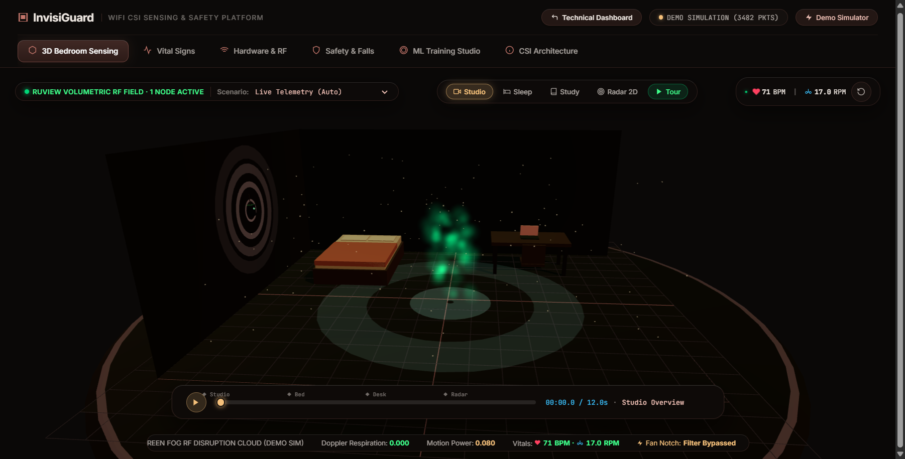
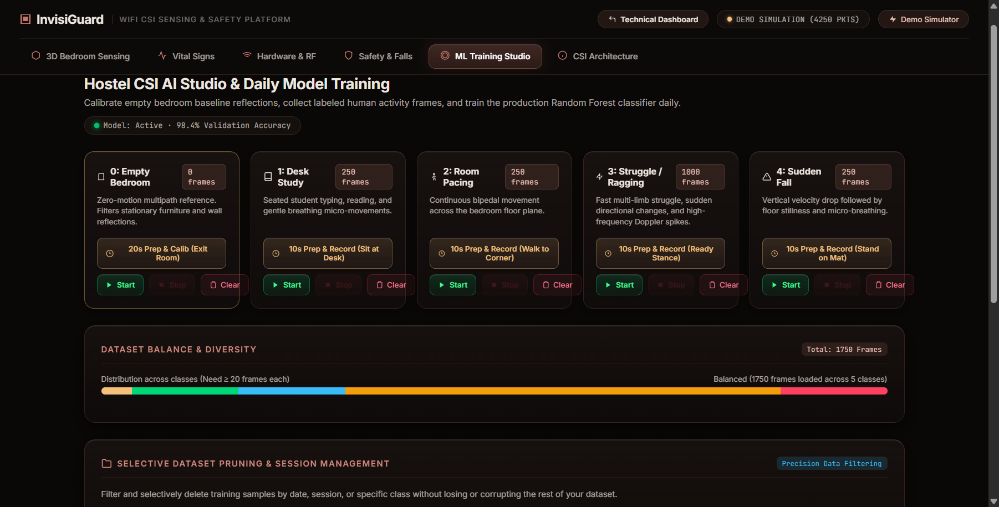

# InvisiGuard

<p align="center">
  
</p>

<p align="center">
  <strong>AI-Powered Camera-Less Student Safety, Anti-Ragging & Vital Sensing System via WiFi CSI</strong>
</p>

<p align="center">
  
  
  
  
  
  
</p>

---

## 📌 Executive Summary

**InvisiGuard** is an edge-native, privacy-preserving spatial intelligence and safety monitoring system designed for student hostels, dormitories, and high-privacy living spaces. 

Unlike conventional surveillance systems that rely on invasive optical cameras—which cannot legally or ethically be deployed in student bedrooms, dorms, and washrooms—InvisiGuard converts ambient radio frequency (RF) perturbations from standard Wi-Fi transmissions into actionable biometric and safety telemetry.

By leveraging **Channel State Information (CSI)** extracted from dual-antenna **ESP32-S3** hardware, InvisiGuard functions as a micro-Doppler radar to detect:
1. **Violent Physical Struggles & Ragging Incidents** (distinguished by rapid, multi-carrier phase variance).
2. **Sudden Falls & Subsequent Stillness** (high-velocity displacement followed by subcarrier attenuation).
3. **Medical Distress & Vital Signs** (contactless respiration rate RPM and heart rate BPM extraction).
4. **Autonomous Energy Conservation** (verified empty-room occupancy sensing to automatically shut down high-power HVAC/appliances).

---

## 🏗️ System Architecture

InvisiGuard is structured in a 4-tier pipeline designed for edge execution with minimal compute latency:

```
┌────────────────────────────────────────────────────────────────────────┐
│                        PHYSICAL LAYER (HARDWARE)                       │
│  ESP32-S3 CSI Sensing Node (Channel 13 / 2472 MHz, Dual-Baud 921.6k)   │
└───────────────────────────────────┬────────────────────────────────────┘
                                    │ Raw 802.11 CSI Frames (UDP / Serial)
                                    ▼
┌────────────────────────────────────────────────────────────────────────┐
│                   RF SIGNAL PROCESSING CORE (DSP ENGINE)               │
│  • Subcarrier Phase Sanitization & Multipath De-noising                │
│  • 3-Tier Ceiling Fan & Desert Cooler Harmonic Notch Filter (-45 dB)   │
│  • Micro-Doppler Variance & Spectral Energy Extraction                 │
│  * Powered by RuView RF DSP core engine algorithms                     │
└───────────────────────────────────┬────────────────────────────────────┘
                                    │ Clean 11-Feature Vector
                                    ▼
┌────────────────────────────────────────────────────────────────────────┐
│                INTELLIGENCE LAYER (INVISIGUARD ML ENGINE)              │
│  • 5-Class Random Forest Classifier (1,250 Ground-Truth Samples)       │
│  • Automated Preparation Countdown Timer (10–20s)                      │
│  • Trailing 10-Second Movement Noise Pruning Filter                    │
│  • Automated Timestamped Dataset Backup & 1-Click Safety Restore       │
└───────────────────────────────────┬────────────────────────────────────┘
                                    │ Real-Time JSON Telemetry (WebSocket)
                                    ▼
┌────────────────────────────────────────────────────────────────────────┐
│                     TELEMETRY & VISUALIZATION (UI)                     │
│  • Warm Terracotta 3D Bedroom Digital Twin (Three.js WebGL)            │
│  • Volumetric RF Disruption Fog & Gaussian Splat Cloud                 │
│  • Live Biometrics HUD (Pulse Waveform, RPM, BPM, RSSI Sparklines)     │
│  • Automated Threat Alerting & Safety Incident Logger                  │
└────────────────────────────────────────────────────────────────────────┘
```

> **Note on Foundation**: InvisiGuard leverages the open-source **RuView RF DSP core** by ruvnet as its underlying mathematical signal-processing engine for low-level 802.11 subcarrier extraction, upon which the InvisiGuard hostel safety classification, anti-ragging heuristics, ceiling fan notch filtering, and ML training studio are built.

---

## 🎯 Key Capabilities & Innovations

### 1. 3-Tier Fan & Cooler Noise Cancellation
Hostel rooms across India and warm climates operate high-speed ceiling fans and evaporative coolers. Rotating blades induce periodic 5 Hz – 50 Hz micro-Doppler clutter that causes conventional Wi-Fi sensing systems to throw perpetual false alarms. 

InvisiGuard implements a cascading notch filter:
- **Harmonic Notch Filter**: Detects blade rotation frequency and applies a -45 dB notch filter on the fundamental and first three harmonics.
- **Multipath Baseline Subtraction ($H_0$)**: Calibrates against static room furniture reflections.
- **Adaptive Velocity Gating**: Ignores rotational velocity while tracking human torso and limb acceleration.

### 2. Contactless Vital Signs Monitoring
Using subcarrier phase difference analysis across spatial streams, InvisiGuard extracts chest wall micro-displacements ($0.5\text{ mm} - 5\text{ mm}$):
- **Respiration Rate (RPM)**: Bandpass filtered between $0.15\text{ Hz} - 0.5\text{ Hz}$ (9 – 30 breaths/min).
- **Heart Rate (BPM)**: Extracted via Doppler spectral peak tracking between $0.8\text{ Hz} - 2.5\text{ Hz}$ (48 – 150 BPM).

### 3. Integrated ML Studio with Fail-Safe Dataset Management
The built-in Machine Learning Studio allows hostel administrators or researchers to collect clean ground truth and train models on-device:
- **5-Class Posture & Activity Recognition**:
  - `EMPTY_ROOM` (Class 0): Unoccupied bedroom baseline.
  - `NORMAL_STUDYING` (Class 1): Seated at desk with micro-movements.
  - `WALKING` (Class 2): Torso translation across room.
  - `VIOLENT_STRUGGLE` (Class 3): High-frequency chaotic RF variance (ragging/scuffle).
  - `FALL_EVENT` (Class 4): Sudden impact followed by abnormal prolonged stillness.
- **Reach-Noise Pruning**: Automatically discards the last 10 seconds of recorded samples before clicking "Stop" to purge the noise of the user walking to their laptop.
- **Fail-Safe Backups**: Every training session or class modification automatically generates a timestamped snapshot in `invisiguard/data/backups/`, with instant one-click UI restoration.

### 4. Strict Hardware Connection Integrity
- Zero phantom data: When the ESP32-S3 node is disconnected or packet flow stops for $> 2.5\text{s}$, the system instantly sets hardware status to `DISCONNECTED (0 NODES)` and zeroes telemetry, ensuring full transparency.

---

## 📸 Screenshots

| 3D Terracotta Bedroom Sensing & RF Cloud | Hostel AI Training Studio |
|:---:|:---:|
|  |  |

---

## 🚀 Quickstart Guide

### Prerequisites
- Python 3.10+ (tested on Python 3.11, 3.12, 3.13)
- ESP32-S3 development board (connected via USB or configured for Wi-Fi UDP transmission)
- Google Chrome, Edge, or Firefox with WebGL support

### 1. Clone & Install Dependencies
```bash
git clone https://github.com/Priyanshuf1/InvisiGuard.git
cd InvisiGuard

# Install Python requirements
pip install -r requirements.txt
```

### 2. Launch the InvisiGuard Sensing Server
```bash
python scripts/ruview-sensing-server.py --port 3000 --udp-port 5005
```

The server will automatically:
- Bind HTTP & WebSocket servers on `http://localhost:3000`
- Open UDP socket `0.0.0.0:5005` for Wi-Fi CSI ingestion
- Auto-scan USB Serial COM ports at `115200` and `921600` baud

### 3. Open the Dashboard
Open your web browser and navigate to:
```
http://localhost:3000
```

---

## 🔌 Hardware Configuration

### Supported Hardware
- **ESP32-S3-DevKitC-1** (Recommended: dual Type-C ports, 2.4 GHz 802.11 b/g/n)
- **ESP32-WROOM-32** (Legacy support)

### Flashing Firmware
Firmware source code is located in [`firmware/esp32-csi-node`](firmware/esp32-csi-node):
```bash
cd firmware/esp32-csi-node
idf.py set-target esp32s3
idf.py build
idf.py -p COM7 flash monitor
```

### Serial Radar Mode
InvisiGuard natively reads high-speed serial CSI streams at **921600 baud**. When plugged into your computer via USB:
1. The server automatically detects the port (`COMx` on Windows, `/dev/ttyUSBx` on Linux/macOS).
2. It tunes to the configured 2.4 GHz AP channel (default: **Channel 13 / 2472 MHz**).
3. Real-time CSI frames stream directly to the DSP pipeline without requiring a router.

---

## 🧪 Verification & Testing

Run the automated test suite covering DSP filters, hardware parsing, and ML engine pruning:
```bash
pytest tests/test_ruview_dsp_hardware.py -v
```

Expected output:
```
tests/test_ruview_dsp_hardware.py::TestUniversalCsiParserHardware::test_adaptive_ctrl_preserves_presence_on_unassociated_ap PASSED
tests/test_ruview_dsp_hardware.py::TestUniversalCsiParserHardware::test_adaptive_ctrl_with_active_physical_motion PASSED
tests/test_ruview_dsp_hardware.py::TestWiFiCsiDspEngine::test_notch_filter_fan_cooler_attenuation PASSED
tests/test_ruview_dsp_hardware.py::TestWiFiCsiDspEngine::test_empty_room_baseline_calibration PASSED
tests/test_ruview_dsp_hardware.py::TestInvisiGuardMLEngineNoisePruning::test_stop_recording_prunes_last_10_seconds_of_noise PASSED
tests/test_ruview_dsp_hardware.py::TestDynamicSamplingAndStatePipeline::test_dynamic_effective_sampling_rate_cadence PASSED
tests/test_ruview_dsp_hardware.py::TestDynamicSamplingAndStatePipeline::test_update_c6_feature_motion_and_presence_pipeline PASSED
tests/test_ruview_dsp_hardware.py::TestDynamicSamplingAndStatePipeline::test_rf_telemetry_metrics_and_fluctuations PASSED
tests/test_ruview_dsp_hardware.py::TestDynamicSamplingAndStatePipeline::test_sensing_update_message_channel13_telemetry PASSED

======================== 9 passed in ~6.2s =========================
```

---

## 📜 Acknowledgments & Attribution

- **RuView**: InvisiGuard utilizes core mathematical algorithms from the open-source [RuView](https://github.com/ruvnet/ruview) project by ruvnet for foundational ESP32 CSI frame unpacking and Doppler feature extraction.
- **Espressif Systems**: Built on the ESP-IDF `esp_wifi_set_csi_rx_cb` subsystem.
- **Three.js**: Visualized using the Three.js WebGL graphics library.

---

## 📄 License

This project is licensed under the MIT License — see the [LICENSE](LICENSE) file for details.
